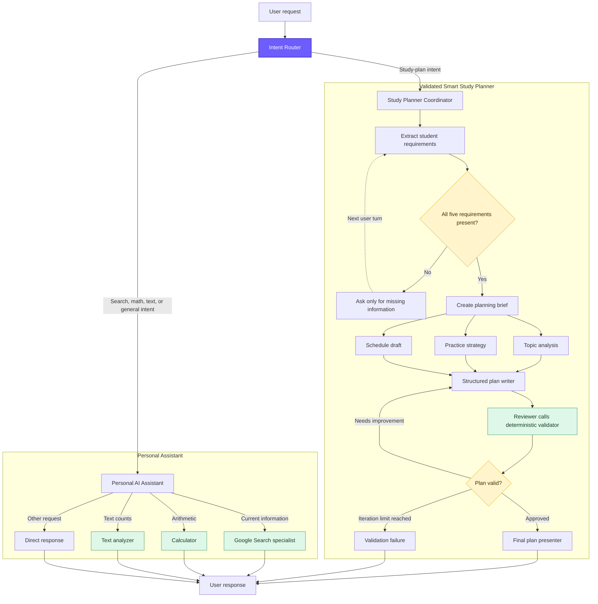

# Syllabus Pilot ADK — Student Companion

Syllabus Pilot is a local [Google Agent Development Kit (ADK)](https://adk.dev/)
multi-agent application. Its active **Student Companion** routes each request to
one of two focused systems:

- a validated study-planning workflow for exam preparation; or
- a personal assistant for current information, arithmetic, text analysis, and
  general conversation.

The planner combines LLM reasoning with deterministic validation. It does not
invent missing study requirements and will not approve a plan that omits supplied
topics, exceeds the daily time limit, or lacks revision and final mock-test coverage.

## Capabilities

| Request | Handler | Behavior |
| --- | --- | --- |
| Study plan or exam timetable | Smart Study Planner | Collects requirements, analyzes topics, drafts a schedule, validates it, and revises when necessary |
| Current or external information | Google Search specialist | Searches the web and returns grounded information with source links when available |
| Arithmetic | Calculator tool | Safely evaluates basic arithmetic expressions without using `eval` |
| Text statistics | Text analyzer tool | Counts characters, words, and sentences in the exact supplied text |
| General conversation | Personal AI assistant | Responds naturally without starting the study-planning workflow |

## Architecture



The study planner uses `SequentialAgent`, `ParallelAgent`, and `LoopAgent`
controllers. Its review loop is capped at two iterations, and approval is based
on the deterministic validator rather than on an LLM judgment alone.

## Study-plan requirements

The planner needs all five values before it creates a plan:

1. Subject
2. Number of preparation days
3. Current preparation level
4. Complete list of syllabus topics
5. Available study hours per day

An approved plan must cover every supplied topic, contain exactly the requested
number of days, stay within the daily time limit, include practice and revision,
and place revision plus a mock test on the final day.

## Project structure

```text
syllabus-pilot-adk/
├── personal_assistant/                 # Active Student Companion entrypoint
│   ├── __init__.py
│   ├── agent.py                        # Router, search agent, assistant, root agent
│   ├── tools.py                        # Safe calculator and text analyzer
│   └── check_models.py                 # Utility for inspecting available models
├── smart_study_planner/                # Validated exam-planning workflow
│   ├── __init__.py
│   ├── agent.py                        # Sequential, parallel, and review-loop agents
│   ├── schemas.py                      # Pydantic requirements and plan schemas
│   ├── validation.py                   # Deterministic study-plan validation
│   ├── fast_api_app.py                 # ADK FastAPI server and feedback endpoint
│   └── app_utils/
│       ├── telemetry.py                # OpenTelemetry/Google Cloud setup
│       └── typing.py                   # API feedback schema
├── tests/
│   ├── unit/
│   │   ├── test_personal_assistant_tools.py
│   │   └── test_study_plan_validation.py
│   ├── integration/
│   │   ├── test_agent.py               # ADK Runner streaming test
│   │   └── test_server_e2e.py          # FastAPI/SSE end-to-end tests
│   └── eval/
│       ├── eval_config.yaml             # Task, tool-use, and response metrics
│       └── datasets/
│           ├── README.md
│           └── basic-dataset.json       # Planner, calculator, text, and search cases
├── archive/                             # Earlier workshop snapshot; excluded from lint
├── .agents-cli-spec.md                  # Requirements and success criteria
├── .dockerignore                        # Prevents local secrets entering images
├── agents-cli-manifest.yaml             # Activates personal_assistant
├── Dockerfile
├── pyproject.toml                       # Dependencies and tool configuration
├── verify_workflow.py                   # Offline agent-tree inspection
└── README.md
```

## Prerequisites

- Python 3.11–3.13
- [uv](https://docs.astral.sh/uv/getting-started/installation/)
- `google-agents-cli`
- A valid Google AI Studio API key, or Google Cloud Application Default
  Credentials for Vertex AI

Install the CLI once:

```powershell
uv tool install google-agents-cli
```

Install the project dependencies:

```powershell
agents-cli install
```

## Configuration

For Google AI Studio, create or update `personal_assistant/.env`:

```dotenv
GOOGLE_GENAI_USE_VERTEXAI=False
GOOGLE_API_KEY=your-valid-api-key
```

For Vertex AI, authenticate and configure a project instead:

```powershell
gcloud auth application-default login
```

```dotenv
GOOGLE_GENAI_USE_VERTEXAI=True
GOOGLE_CLOUD_PROJECT=your-project-id
GOOGLE_CLOUD_LOCATION=global
```

Use a model-supported location for `GOOGLE_CLOUD_LOCATION`. Never commit `.env`
files; they are ignored by Git and Docker.

## Run locally

Launch the ADK playground:

```powershell
agents-cli playground
```

The active agent is `personal_assistant`, as configured in
`agents-cli-manifest.yaml`.

Example prompts:

```text
Create a 4-day Physics plan for a beginner covering Motion, Force, and Energy.
I can study 2.5 hours per day.

Calculate 25000 * 18 / 100.

Count the words and sentences in: Study steadily. Rest well!

Search for the current official Google ADK evaluation documentation.
```

## Validate and test

Inspect the complete agent hierarchy without calling Gemini:

```powershell
uv run python verify_workflow.py
```

Run deterministic unit tests:

```powershell
uv run pytest tests/unit
```

Run the required pre-deployment suite:

```powershell
uv run pytest tests/unit tests/integration
```

Integration tests require valid model credentials. The API end-to-end tests also
require Google Cloud credentials because the FastAPI application initializes
Cloud Logging.

Run code-quality checks:

```powershell
agents-cli lint
```

## Behavioral evaluation

The evaluation dataset covers:

- requesting missing study-plan requirements;
- generating a complete two-day plan;
- calculator routing;
- text-analysis routing; and
- current-information search routing.

Generate traces and grade them:

```powershell
agents-cli eval generate
agents-cli eval grade
```

Configured metrics assess task completion, tool usage, and final-response quality.
Behavioral response quality belongs in ADK evals rather than deterministic pytest
assertions because LLM output is non-deterministic.

## API server

Run the FastAPI application directly:

```powershell
uv run uvicorn smart_study_planner.fast_api_app:app --host 0.0.0.0 --port 8000
```

Important endpoints include:

- `GET /docs` — generated API documentation
- `POST /run_sse` — streamed ADK runs
- `POST /feedback` — structured response feedback
- `/apps/personal_assistant/...` — sessions for the active Student Companion

Sessions are currently stored in memory and are lost when the process restarts.

## Docker

Build the local image:

```powershell
docker build -t syllabus-pilot-adk .
```

Local `.env` files are excluded from the image. Supply credentials securely at
runtime rather than copying them into the container.

## Deployment status

This repository is currently a local prototype:

- deployment target: `none`
- session storage: in memory
- CI/CD runner: not configured
- datastore: none

When the application has passed its evaluation thresholds, add a deployment target
with `agents-cli scaffold enhance`. Run `agents-cli deploy` only after explicit
human approval.

## Technology

- Google ADK 2.x
- Gemini (`gemini-3.8-flash`, preserved from the existing project)
- Python and Pydantic
- FastAPI and Server-Sent Events
- OpenTelemetry and Google Cloud Logging
- pytest, Ruff, and `agents-cli eval`
